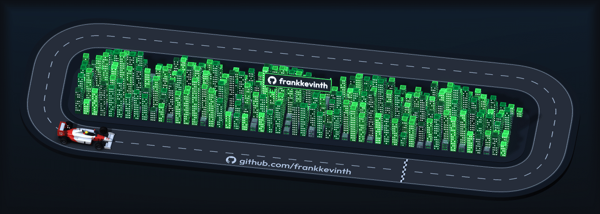
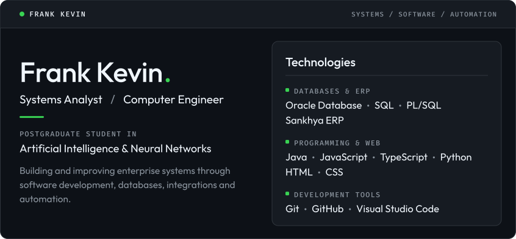
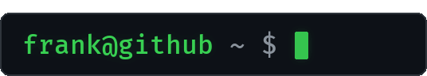
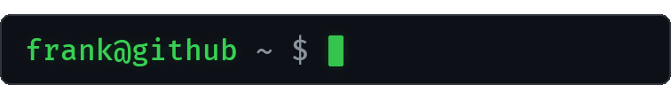
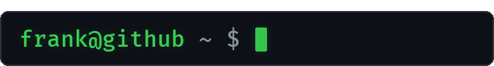
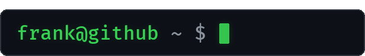

  

  <picture>
    <source media="(max-width: 1011.98px)" srcset="assets/identity-card-compact.svg">
    
  </picture>

  
  
  
  

  <picture>
    <source media="(prefers-reduced-motion: reduce)" srcset="assets/terminal/whoami.png">
    
  </picture>

My work centers on enterprise systems: software development, database engineering with Oracle SQL and PL/SQL, ERP integrations on Sankhya, and the automation of the business processes that run on them.

  <picture>
    <source media="(prefers-reduced-motion: reduce)" srcset="assets/terminal/tech-stack.png">
    
  </picture>

   
  
  
  
  

   
  
  
  
  
  
  

   
  
  
  

  <picture>
    <source media="(prefers-reduced-motion: reduce)" srcset="assets/terminal/focus.png">
    
  </picture>

**Professional experience**

- Enterprise Systems
- Database Development
- Systems Integration
- Process Automation

**Currently studying**

- Artificial Intelligence & Neural Networks
- Full Stack Development

  <picture>
    <source media="(prefers-reduced-motion: reduce)" srcset="assets/terminal/links.png">
    
  </picture>

 

  <i>Engineering solutions. Automating processes. Exploring intelligent systems.</i>

